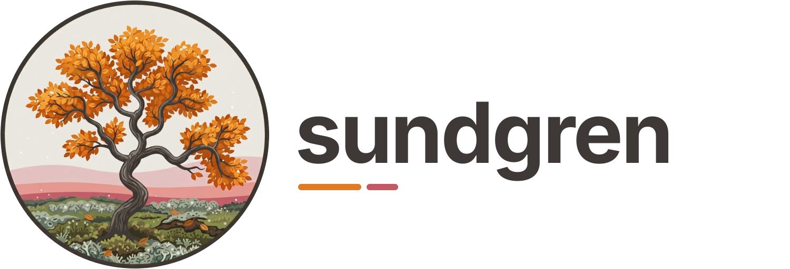

<picture>
  <source media="(prefers-color-scheme: dark)" srcset="https://raw.githubusercontent.com/axean/sundgren/main/docs/_static/brand/sundgren-logo-dark.svg">
  
</picture>

sundgren helps you view, understand and measure what large git repositories contain, and how
they compare with each other. When there is more text than anyone can read, it has to be digested
in a meaningful way before the details make sense. Nobody can remember everything they wrote, the
choices they made and why, or what exactly happened when; LLMs only amplify the noise.

It is a toolkit of personal utilities for that: where code is, what happened to it, what depends
on what, where a text originated and why it was written the way it was. It is for technical people
who do code review, closer to where the code runs than the browser is.

- **VS Code extension**: a map of branches around a base, each with its stage and state;
  containment of every branch in a target; a branch line by line; where a file came from. On the
  [Marketplace](https://marketplace.visualstudio.com/items?itemName=axean.sundgren).
- **Command line**: `pip install sundgren`, then `sundgren contain A B --base main`,
  `sundgren graph`, `sundgren relate-repos OTHER`,
  `sundgren origin FILE --compare-repo DIR --at REV`, `sundgren outline FILE`.

[Documentation](https://axean.github.io/sundgren/), with live demos.

## Languages

- **Any text file** is compared line by line.
- **Python** (`.py`, `.pyi`), **Rust** (`.rs`) and **C** (`.c`, `.h`) are also read as code:
  containment per function, class or other item, with where each went in the other branch (tagged
  _moved_ or _renamed_), and comment lines (license headers, doc comments) left out.
  - Python: `def`, `class`.
  - Rust: `fn`, `struct`, `enum`, `union`, `trait`, `impl`, `mod`, `const`, `static`, `type`,
    `macro_rules!`.
  - C: functions, `struct`, `union`, `enum`, `#define`.

## Development

How to build, test and release sundgren:
[DEVELOPMENT.md](https://github.com/axean/sundgren/blob/main/DEVELOPMENT.md).

## License

Apache-2.0. See [LICENSE](https://github.com/axean/sundgren/blob/main/LICENSE).
