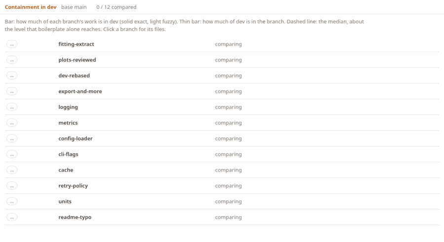

# Containment

> [!NOTE]
> A prototype. How it decides what counts as the same work is still open.

Git records where commits came from, not what is in them. Once work is rebased, squashed or
extracted from a dev branch into its own merge request, git no longer knows it is the same work.
sundgren compares branches by their content instead: for two branches, how much of the work each
added since it left the base is found in the other. This is the panel, on a made-up repository
whose `dev` branch has three features:

<iframe class="sg-demo" src="_static/demo/containment.html" title="The sundgren containment panel, on a made-up repository" loading="lazy"></iframe>

## Reading it

- **Thick bar**: how much of the branch's work is in the target. Solid is lines found as they
  are; light is lines found after small edits (at least 90 % similar).
- **Thin bar**: how much of the target's work is in the branch.
- **Label**: *in target* when the branch is (almost) all in the target but not the other way round,
  as for an extraction; *same work* when both are; *overlap*, *unrelated*, or *nothing ahead*
  for a branch that is already merged.
- **Dashed line**: the median of all branches, roughly what shared boilerplate (license headers,
  common lines) reaches on its own. In the demo that is the made-up license header every module
  starts with.
- Click a branch to see its files. In Python, Rust and C files, sundgren also reads the code:
  each file lists its functions and classes with how much of each is in the target, and the item
  there most of it was found in (*→ name*; in another file, the file's name first). A note above
  gives the containment without the lines that are only comments.

In the demo, `fitting-extract` is an extraction of `dev`, `plots-reviewed` one that was edited in
review (found through the fuzzy matches), and `dev-rebased` the same work rebased onto a newer
`main`. `export-and-more` shares part of its work, `logging` none beyond the license header,
and `readme-typo` has nothing ahead of `main`. The unrelated branches score 10–17 % from the
license header alone; without comment lines they are at 0 %.

## In VS Code

Run **sundgren: Show Containment**, pick the base (for example `main`) and the target branch.
Every other branch is compared with the target, a few at a time, and takes its place in the list as
soon as it is done:



## From the command line

```console
$ sundgren contain feature dev --base main --format text
```

compares two branches and prints `sundgren.containment/0` JSON, or a summary with
`--format text`. `--fuzzy T` sets how similar an edited line must be (default 0.9; 1 for exact
matches only).
