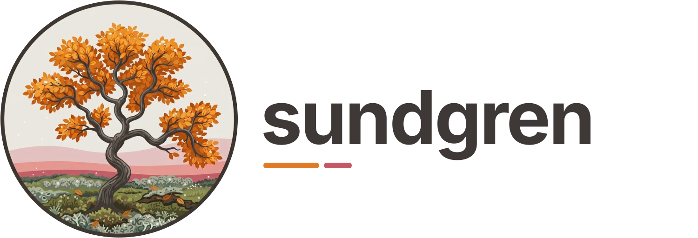
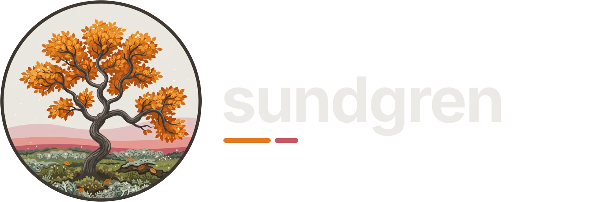

# sundgren

<p class="sg-hero"></p>

sundgren is a coverage diff tool, written in Rust. It is an analysis tool for understanding large
and complex codebases: it shows how a patch changes the coverage of your code. It runs your tests
with coverage on the tree before the patch and on the tree after it, and reports the lines,
branches, functions and test outcomes that changed. It is also a [VS Code extension](vscode.md).

The comparison works with any coverage tool that writes lcov. The built-in presets are for Python
(pytest with coverage.py) and Rust (cargo-llvm-cov or cargo-tarpaulin), and the extension works
with Python and Rust projects.

## Why

LLM agents write a lot of code, and they are good at it. But they write more than anyone has time
to read, so reading the code is no longer enough to understand it. sundgren is a diagnostic tool
for looking at how one patch changes a large and complex codebase.

Tests describe what should happen when code runs, and coverage tools record which lines run during
the tests. Comparing the coverage before and after a patch shows how the patch changes what the
tests run. You can use it to refactor tests, for example to find unit tests that are redundant, or
to check that a rewritten test still covers what the old one did.

It is for developers who want a deeper understanding of their codebase. Since it is a
command-line tool with a JSON report, agents can use it too when they refactor code.

> [!NOTE]
> Coverage shows which lines ran, not whether their results were checked. A test whose removal
> loses no coverage can still be the only one that asserts something.

*Sundgren* is Swedish for "sound branch", and my mother's family name.

## What it looks like

Skipping `test_divide`, the only test that calls `divide`, makes `divide` go dark:

```{sundgren-graphic} examples/skip_divide
```

The [examples](examples.md) show the project, the patch and the command behind this, and more
cases in Python and Rust.

## Install

Install the `sundgren` package from [PyPI](https://pypi.org/project/sundgren/) as a tool, with
uv or pipx. It is a single program for Linux and macOS and needs no Python to run. sundgren works
with Python projects (coverage.py and pytest), Rust projects (cargo-llvm-cov or cargo-tarpaulin)
and any tool that writes lcov.

## Where next

- [Examples](examples.md): common cases, from a patch that only touches tests to your own commands
  with placeholders.
- [How it works](how-it-works.md): the worktrees, which tests run, and how the two runs are
  compared.
- [Reference](reference.md): every option, preset key, placeholder, exit code and warning.
- [VS Code](vscode.md): pluck a test from the editor and see what it does to coverage.
- [Changelog](changelog.md)
