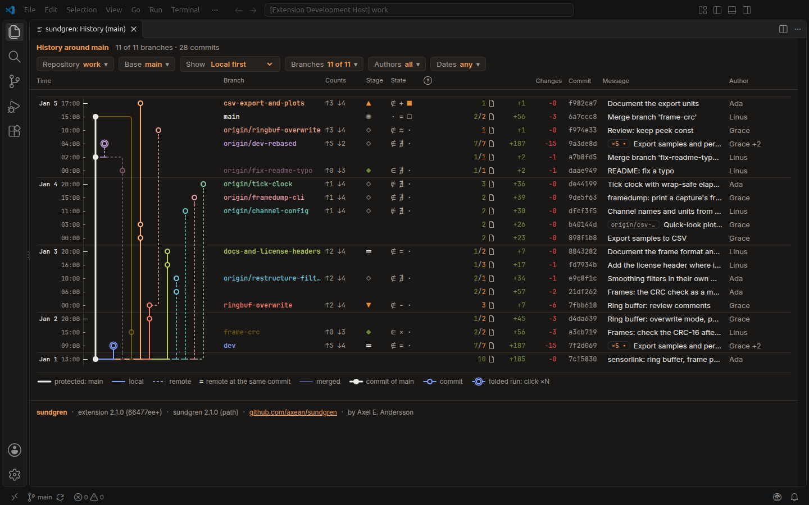
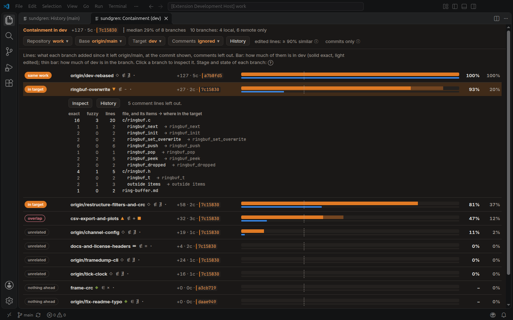
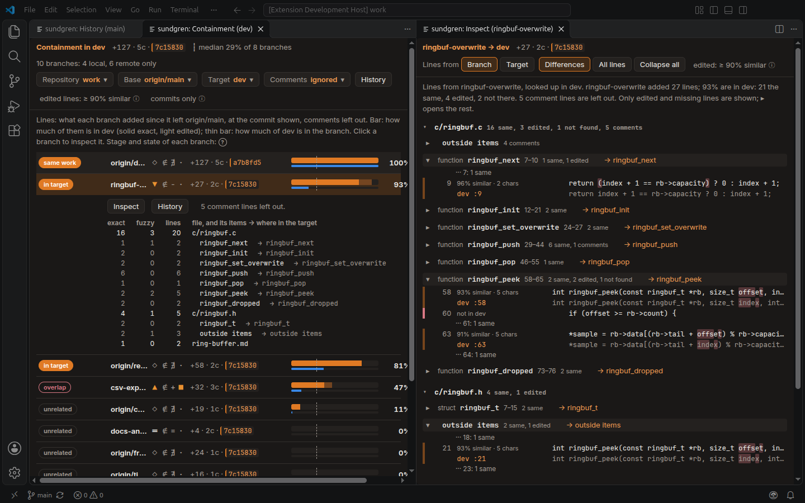

# sundgren

**View, understand and measure what git repositories contain, and how they compare with each
other.**

When there is more text than anyone can read, it has to be digested in a meaningful way before
the details make sense. That was true before, too: when I wrote all my code by hand, I still
forgot things I had written, choices I had made and why I made them, what exactly happened at a
certain point in time. Nobody can remember everything, and LLMs only amplify the noise.

sundgren is a toolkit of personal utilities for making sense of that: where code is, what
happened to it, what depends on what, where a text originated and why it was written the way it
was. It is built on git, and reads some languages as code for more meaningful comparisons.

It is for technical people who do code review. Reviewing in the browser is a drag; sundgren
brings it closer to the environment where the code runs, where you can visualize and measure.

## History

**sundgren: Show History** draws the branches around a base branch as a vertical map, newest on
top: where each forked and merged, next to the commits in fixed columns. Show local branches
first, recent activity, your own, or those most like a branch, then tick or untick any in the
Branches list. Filter by author and by date (a calendar). Quiet runs of commits are folded
(click ×N). Click a commit's hash to open it on GitHub or GitLab (from the `origin` remote).
Left of the hash: the files the commit changed, by kind, and the lines it added and removed.
Each branch's label shows its stage (Draft, Steady, Budding, Done, ...) and its state: merged
or not, how it stands against its remote branch, and whether it is checked out with uncommitted
changes. The circled ? explains the symbols. The map redraws by itself when a branch moves.
**History** in the Containment panel opens it too.

**sundgren: Show History With Another Repository…** adds the branches of a clone of a related
repository (a copy, a fork, a mirror), and marks where the two split and synced.

## Containment

**sundgren: Show Containment** compares every branch with a target branch you pick: how much of
each branch's work is already in the target, and how much of the target's is in it. A branch's
work is what it added since it left the canonical branch (`origin/HEAD`, else `main`).

- Each branch gets a label: _in target_ for an extraction, _same work_, _overlap_, _unrelated_.
- Edited lines count too: a line at least 90 % similar to one in the target is found.
- Comment lines (license headers, doc comments) are left out, in Python, Rust, C, C++,
  JavaScript and TypeScript; a toggle counts them.
- In Python, Rust, C, C++, JavaScript and TypeScript, sundgren reads the code: each function and
  class shows where it went in the target, tagged _moved_ or _renamed_.
- Each branch shows its stage and state, as in History: merged or not, how it stands against its
  remote branch, and whether it is checked out with uncommitted changes. The circled ? explains
  the symbols.

## Inspect

**Inspect** on a branch shows what is different: every line it added that the target doesn't have,
or has edited, next to the target's line, with the changed characters marked. The rest is folded.

## Origin

**sundgren: Show Origin** says where the file in the editor comes from in another repository: for
each commit you pick there (branches, tags), the file its lines are most found in, and how far
ahead of the next file it is. Click a row to inspect the file against it line by line.

## Outline

**sundgren: Show Outline** shows the file in the editor as sundgren reads it: its functions and
classes, and its comments and strings.

## Buttons and menus

Everything sundgren adds to VS Code's own UI says "sundgren:". Each place can be turned off in
Settings, under sundgren; the commands are always in the Command Palette.

- `sundgren.show.statusBar`: a tree in the status bar, a menu of Show History, Show Containment
  and Show Outline.
- `sundgren.show.sourceControlButton`: **sundgren: Show History** in the Source Control title bar.
- `sundgren.show.sourceControlMenu`: Show History and Show Containment when you right-click a
  repository in the Source Control view.

## Repositories

With several repositories to choose from (open folders, repositories in folders below them, their
submodules, the active file's), the commands ask which one once and remember it for the workspace.
`sundgren.repositoryDepth` (3) is how many folder levels down to look. Worktrees aren't listed:
their branches show where they are checked out. **Repository** in the History and
Containment toolbars picks another. In the Source Control view, right-click a repository to open
History or Containment there.

## Languages

- **Any text file** is compared line by line.
- **Python**, **Rust**, **C**, **C++**, **JavaScript** and **TypeScript** are also read as code,
  with [tree-sitter](https://tree-sitter.github.io/): containment per function, class or other
  item, with where each went in the other branch (tagged _moved_ or _renamed_), and comment lines
  (license headers, doc comments) left out.

## Settings

| Setting                   |                                                                                                    |
| ------------------------- | -------------------------------------------------------------------------------------------------- |
| `sundgren.base`           | The canonical branch a branch's work is counted from. Empty: the repository's default branch.      |
| `sundgren.protected`      | Branch name patterns the history draws in the protected colour (`main`, `master`).                 |
| `sundgren.historyPage`    | Commits of the base the history reads first, and adds with each **Load older** (50).               |
| `sundgren.historyRefresh` | Seconds between checks for changed branches, tags or HEAD; the open history redraws (5; 0: never). |
| `sundgren.path`           | A `sundgren` binary to use instead of the bundled one.                                             |

## Next

- Comparing syntax trees in diffs, not only lines.
- `gh` and `glab` utilities to get through code reviews faster, with feedback given from the
  editor instead of the browser.

## Platforms

Linux (x64, arm64) and macOS (Intel, Apple silicon); the `sundgren` binary is bundled. sundgren is
also a command line tool: `pip install sundgren`.

More: [documentation](https://axean.github.io/sundgren/), with live demos ·
[source](https://github.com/axean/sundgren) · [issues](https://github.com/axean/sundgren/issues).
Apache-2.0.
